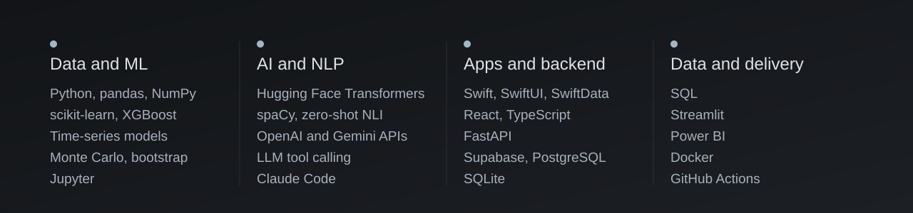

  

I'm Maxim, a Quant Developer and Platform Engineer in asset management, currently doing an MSc in AI & Data Science in Vienna.

Most of my work sits where machine learning meets messy real-world data: forecasting prices across market regimes, scoring corporate reports with language models, and making statistical testing a habit rather than an afterthought. Outside work I build my own products end to end, from the model to the app around it. I hold them to two rules: a result has to survive out-of-sample, and personal data should stay with the person it belongs to.

Before that I studied Business Informatics at WU Vienna, where my thesis built an NLP pipeline for detecting greenwashing in ESG reports.

### What I work on

- **Forecasting and quantitative research.** Time-series models, regime classification and Monte Carlo simulation, checked against a null model before I trust the result. *marbl.energy, FinSight*
- **Language models and NLP.** Zero-shot classification, LLM applications with tool calling, and evaluation against human experts. *GW-Pilot, FinSight*
- **Privacy-first applied AI.** Analytics that run on the device, encryption by default, and careful use of cloud models. *HealthPulse*

### Projects

| Project | What it is | Stack |
|---|---|---|
| **HealthPulse** *(private)* | Fitness and recovery app for iPhone and Apple Watch. Training plans, nutrition with an AI food scanner, and a readiness score computed on-device from HRV, sleep and training load. Health data is encrypted on the device, with a move to a fully local-first model under way. On TestFlight, App Store release coming soon. | SwiftUI · SwiftData · CryptoKit · FastAPI · Supabase |
| **FinSight** *(private)* | Research lab for trend-following strategies: backtests, walk-forward and Monte Carlo analysis, and significance tests against bootstrap and GARCH null models, feeding a paper trader with a hard killswitch. Includes an LLM assistant with tool access to the research data. Current finding: the test portfolio beats SPY, but not its own null. | Python · FastAPI · React · SQLite |
| **GW-Pilot** *(Bachelor thesis, private)* | NLP pipeline that scores ESG reports on greenwashing risk: vague language, specificity and emission consistency. Applied to 46 reports from 12 asset managers and validated against 42 domain experts across 840 ratings. | Python · spaCy · BART-MNLI |
| [**marbl.energy**](https://github.com/builtbymaxim/DsLab25W_marbl.energy) *(university DS lab)* | Day-ahead electricity price forecasting for European wholesale markets. A Mix-of-Experts setup: an XGBoost regime classifier routes each day to a specialised regressor. | Python · XGBoost · Streamlit |
| [**Noema**](https://github.com/builtbymaxim/noema) *(prototype)* | Digital wellness app to help you use your phone less: energy check-ins, mood journaling and trend dashboards. | React · TypeScript |

### Tools

  

### Get in touch

Happy to talk about quant engineering, machine learning and privacy-first products.

